<picture>
  <source media="(prefers-color-scheme: dark)" srcset="../assets/logo-dark.svg">
  <source media="(prefers-color-scheme: light)" srcset="../assets/logo-light.svg">
  
</picture>

<picture>
  <source media="(prefers-color-scheme: dark)" srcset="https://readme-typing-svg.demolab.com?font=Noto+Sans+SC&weight=600&size=17&duration=4000&pause=1500&color=FFC7EC&center=true&vCenter=true&width=880&height=42&lines=%E6%97%A0%E8%AE%BA%E8%82%A4%E8%89%B2%E4%B8%8E%E6%80%A7%E5%88%AB%EF%BC%8C%E9%87%8D%E8%A6%81%E7%9A%84%E6%98%AF%E4%BD%A0%E6%9C%AC%E8%B4%A8%E4%B8%8A%E6%98%AF%E6%80%8E%E6%A0%B7%E7%9A%84%E4%BA%BA;%E5%8F%AA%E5%96%84%E5%BE%85%E5%AF%B9%E8%87%AA%E5%B7%B1%E6%9C%89%E7%94%A8%E7%9A%84%E4%BA%BA%EF%BC%8C%E8%80%8C%E5%86%B7%E5%BE%85%E6%97%A0%E7%94%A8%E4%B9%8B%E4%BA%BA%EF%BC%8C%E8%BF%99%E6%98%AF%E6%9C%80%E5%8F%AF%E6%82%B2%E7%9A%84%E4%BA%8B;%E5%86%99%E4%BB%A3%E7%A0%81%E3%80%82%E5%AD%A6%E4%B9%A0%E3%80%82%E5%88%86%E4%BA%AB%E3%80%82%E9%87%8D%E5%A4%8D%E3%80%82;%E6%8A%8A%E4%B8%80%E5%88%87%E9%83%BD%E8%87%AA%E5%8A%A8%E5%8C%96;%E6%8A%8A%E6%95%B0%E6%8D%AE%E5%8F%98%E6%88%90%E5%86%B3%E7%AD%96;%E8%87%AA%E7%94%B1%E5%88%9B%E4%BD%9C%EF%BC%8C%E4%B9%9F%E8%AE%A9%E4%BB%96%E4%BA%BA%E8%87%AA%E7%94%B1%E5%88%9B%E4%BD%9C">
  <source media="(prefers-color-scheme: light)" srcset="https://readme-typing-svg.demolab.com?font=Noto+Sans+SC&weight=600&size=17&duration=4000&pause=1500&color=C2408F&center=true&vCenter=true&width=880&height=42&lines=%E6%97%A0%E8%AE%BA%E8%82%A4%E8%89%B2%E4%B8%8E%E6%80%A7%E5%88%AB%EF%BC%8C%E9%87%8D%E8%A6%81%E7%9A%84%E6%98%AF%E4%BD%A0%E6%9C%AC%E8%B4%A8%E4%B8%8A%E6%98%AF%E6%80%8E%E6%A0%B7%E7%9A%84%E4%BA%BA;%E5%8F%AA%E5%96%84%E5%BE%85%E5%AF%B9%E8%87%AA%E5%B7%B1%E6%9C%89%E7%94%A8%E7%9A%84%E4%BA%BA%EF%BC%8C%E8%80%8C%E5%86%B7%E5%BE%85%E6%97%A0%E7%94%A8%E4%B9%8B%E4%BA%BA%EF%BC%8C%E8%BF%99%E6%98%AF%E6%9C%80%E5%8F%AF%E6%82%B2%E7%9A%84%E4%BA%8B;%E5%86%99%E4%BB%A3%E7%A0%81%E3%80%82%E5%AD%A6%E4%B9%A0%E3%80%82%E5%88%86%E4%BA%AB%E3%80%82%E9%87%8D%E5%A4%8D%E3%80%82;%E6%8A%8A%E4%B8%80%E5%88%87%E9%83%BD%E8%87%AA%E5%8A%A8%E5%8C%96;%E6%8A%8A%E6%95%B0%E6%8D%AE%E5%8F%98%E6%88%90%E5%86%B3%E7%AD%96;%E8%87%AA%E7%94%B1%E5%88%9B%E4%BD%9C%EF%BC%8C%E4%B9%9F%E8%AE%A9%E4%BB%96%E4%BA%BA%E8%87%AA%E7%94%B1%E5%88%9B%E4%BD%9C">
  
</picture>

      

   

## 关于我

我写程序、做游戏、创作音乐、做3D建模，也画设计稿——每个领域都想一点点做得更好。2011年开始自学编程：最初是在小学时为诺基亚和索尼爱立信按键手机修改J2ME（Java）游戏。

<table>
<tr>
<td width="33%" valign="top"><b>软件</b> 桌面与Web：Electron、Qt、PHP、Python。能自动化的，我都会自动化。</td>
<td width="33%" valign="top"><b>游戏</b> 正在用Unreal Engine 5开发三款游戏。也用过Unity、Godot和Source。</td>
<td width="33%" valign="top"><b>3D</b> 用Blender和Cinema 4D建模，用RenderMan渲染，用Substance制作材质。</td>
</tr>
<tr>
<td width="33%" valign="top"><b>音乐</b> FL Studio与Ableton。原创、Cover和游戏配乐。</td>
<td width="33%" valign="top"><b>设计与视频</b> 用Figma和Adobe XD做界面，用Photoshop做图形，用Premiere Pro、After Effects、DaVinci Resolve和CapCut剪辑视频。</td>
<td width="33%" valign="top"><b>逆向与Mod</b> 喜欢研究引擎和软件的内部原理：Source、Unreal、Unity、Godot、Blender、FL Studio、Ableton。</td>
</tr>
</table>

- **正在做:** 用Unreal Engine 5开发三款游戏
- **正在学:** Vue、JavaScript、TypeScript、C++、CMake、Qt、Lua
- **寻找:** 游戏或应用开发公司的工作机会，也欢迎合作邀约
- **目标:** 找到一份编程工作；发布自己所有的游戏；创造能帮助他人创作的东西——厂牌、软件、框架
- **欢迎提问:** 什么都可以问，尤其是创作相关的。任何想法我都乐意帮忙
- **方向:** 前端、后端、全栈、游戏开发、移动开发、3D、机器学习、设计
- **Game Jam:** Ludum Dare 2023
- **代码之外:** 音乐、游戏、绘画

## 技术栈

<table>
<tr>
<td width="170"><b>熟练使用</b></td>
<td> </td>
</tr>
<tr>
<td width="170"><b>正在学习</b></td>
<td></td>
</tr>
<tr>
<td width="170"><b>框架</b></td>
<td></td>
</tr>
<tr>
<td width="170"><b>引擎与3D</b></td>
<td>   </td>
</tr>
<tr>
<td width="170"><b>设计与视频</b></td>
<td>   </td>
</tr>
<tr>
<td width="170"><b>音乐</b></td>
<td> </td>
</tr>
<tr>
<td width="170"><b>工具</b></td>
<td> </td>
</tr>
</table>

## 项目

<table>
<tr>
<td width="50%" valign="top">
<h3><a href="https://github.com/Arkomiko/OshiMakiKey-Studio">OshiMakiKey Studio</a></h3>
用于配置CH552芯片宏键盘（6个按键＋旋钮）的便携工具：快捷键、多媒体、鼠标和系统操作。设置直接写入设备内存，无需驱动。
  
   
</td>
<td width="50%" valign="top">
<h3><a href="https://github.com/Arkomiko/SFM_C2UI">SFM C2UI</a></h3>
现代外壳下的Source Filmmaker：1:1读取SFM的模型、材质、地图和会话并直接编辑，无需运行sfm.exe。界面风格参考Steam库和Unreal Engine 5。开发已暂停。
  
   
</td>
</tr>
<tr>
<td width="50%" valign="top">
<h3><a href="https://github.com/Arkomiko/Arkomiko.Music">Arkomiko.Music</a></h3>
Arkomiko的音乐播放与作品目录网站：发行作品、技术演示、Cover、采样包和授权信息。基于Astro的静态站点，Vue播放器带频谱显示，支持深色和浅色主题。
  
  
</td>
<td width="50%" valign="top">
<h3><a href="https://github.com/Arkomiko/MiliPlain">MiliPlain</a></h3>
新项目，详情即将公布。
  

</td>
</tr>
<tr>
<td width="50%" valign="top">
<h3><a href="https://handakote.itch.io/goliathchild">Goliath Child</a></h3>
视觉小说：惊悚、日常、哲学、心理。面向Windows、macOS和Linux的团队作品，我负责音乐与音效。
  
 
</td>
<td width="50%" valign="top">
<h3>Unreal Engine 5游戏</h3>
三个项目开发中，详情稍后公布。
  
 
</td>
</tr>
</table>

## GitHub统计

<picture>
  <source media="(prefers-color-scheme: dark)" srcset="https://github-readme-stats.vercel.app/api?username=Arkomiko&show_icons=true&include_all_commits=true&custom_title=Arkomiko%20%E7%9A%84%20GitHub%20%E7%BB%9F%E8%AE%A1&bg_color=26222b&title_color=ffc7ec&text_color=e9dfee&icon_color=b983ff&ring_color=ff8fc8&hide_border=true&border_radius=12&locale=cn">
  <source media="(prefers-color-scheme: light)" srcset="https://github-readme-stats.vercel.app/api?username=Arkomiko&show_icons=true&include_all_commits=true&custom_title=Arkomiko%20%E7%9A%84%20GitHub%20%E7%BB%9F%E8%AE%A1&bg_color=fff5fb&title_color=c2408f&text_color=3b2f40&icon_color=8e4fe0&ring_color=e0479e&hide_border=true&border_radius=12&locale=cn">
  
</picture>
<picture>
  <source media="(prefers-color-scheme: dark)" srcset="https://github-readme-stats.vercel.app/api/top-langs/?username=Arkomiko&layout=compact&langs_count=8&bg_color=26222b&title_color=ffc7ec&text_color=e9dfee&icon_color=b983ff&ring_color=ff8fc8&hide_border=true&border_radius=12&locale=cn">
  <source media="(prefers-color-scheme: light)" srcset="https://github-readme-stats.vercel.app/api/top-langs/?username=Arkomiko&layout=compact&langs_count=8&bg_color=fff5fb&title_color=c2408f&text_color=3b2f40&icon_color=8e4fe0&ring_color=e0479e&hide_border=true&border_radius=12&locale=cn">
  
</picture>

<picture>
  <source media="(prefers-color-scheme: dark)" srcset="https://streak-stats.demolab.com?user=Arkomiko&locale=zh_Hans&border_radius=12&hide_border=true&background=26222b&ring=ff8fc8&fire=ff8fc8&currStreakNum=ffc7ec&sideNums=ffc7ec&currStreakLabel=b983ff&sideLabels=e9dfee&dates=a99bb0&stroke=4a3f52">
  <source media="(prefers-color-scheme: light)" srcset="https://streak-stats.demolab.com?user=Arkomiko&locale=zh_Hans&border_radius=12&hide_border=true&background=fff5fb&ring=e0479e&fire=e0479e&currStreakNum=c2408f&sideNums=c2408f&currStreakLabel=8e4fe0&sideLabels=3b2f40&dates=7a6a80&stroke=f0d6e8">
  
</picture>

<picture>
  <source media="(prefers-color-scheme: dark)" srcset="https://github-trophies.vercel.app/?username=Arkomiko&no-frame=true&no-bg=true&margin-w=6&row=1&column=7&theme=radical">
  <source media="(prefers-color-scheme: light)" srcset="https://github-trophies.vercel.app/?username=Arkomiko&no-frame=true&no-bg=true&margin-w=6&row=1&column=7&theme=flat">
  
</picture>

<picture>
  <source media="(prefers-color-scheme: dark)" srcset="https://activity-graph.vercel.app/graph?username=Arkomiko&area=true&hide_border=true&radius=12&custom_title=%E6%9C%80%E8%BF%91%E4%B8%80%E4%B8%AA%E6%9C%88%E7%9A%84%E8%B4%A1%E7%8C%AE&bg_color=26222b&color=e9dfee&title_color=ffc7ec&line=b983ff&point=ffc7ec&area_color=b983ff">
  <source media="(prefers-color-scheme: light)" srcset="https://activity-graph.vercel.app/graph?username=Arkomiko&area=true&hide_border=true&radius=12&custom_title=%E6%9C%80%E8%BF%91%E4%B8%80%E4%B8%AA%E6%9C%88%E7%9A%84%E8%B4%A1%E7%8C%AE&bg_color=fff5fb&color=3b2f40&title_color=c2408f&line=e0479e&point=8e4fe0&area_color=f9a8d4">
  
</picture>

<picture>
  <source media="(prefers-color-scheme: dark)" srcset="https://raw.githubusercontent.com/Arkomiko/Arkomiko/output/snake-dark.svg">
  <source media="(prefers-color-scheme: light)" srcset="https://raw.githubusercontent.com/Arkomiko/Arkomiko/output/snake-light.svg">
  
</picture>

## 最新视频与音乐

<!-- LATEST:START -->
<!-- LATEST:END -->

此列表自动更新。

## 我的最爱

<b>游戏</b>

- Detroit: Become Human
- Kena: Bridge of Spirits
- Mirror's Edge
- Mirror's Edge Catalyst
- Dishonored
- Black Mesa

<b>音乐</b>

- Monstercat, NCS, Virtual Riot, Geoxor, Chime, Exyl, Stonebank, Tristam, Pixel Terror, Braken, The Eden Project, Sex Whales, TULE (Lost Sky), Sub Urban, Grabbitz, Peper Skies, Terminate, Bossfight, Apashe, Ace Aura, Aero Chord, Aiobahn, Alan Walker, Bishu, Bonobo, Bad Computer, Crankdat 等等

<b>动画</b>

- 石纪元
- 赛博朋克：边缘行者
- GATE 奇幻自卫队
- 孤独摇滚！
- 铁腕Birdy DECODE
- 约定的梦幻岛
- 命运石之门
- 死亡笔记
- 忧国的莫里亚蒂

<b>电影</b>

- 星际穿越
- 盗梦空间
- 小丑
- 绿里奇迹
- 冒牌天神

## 联系方式

        

## 支持我

你的支持将用于制作新的游戏、音乐和工具。

 

